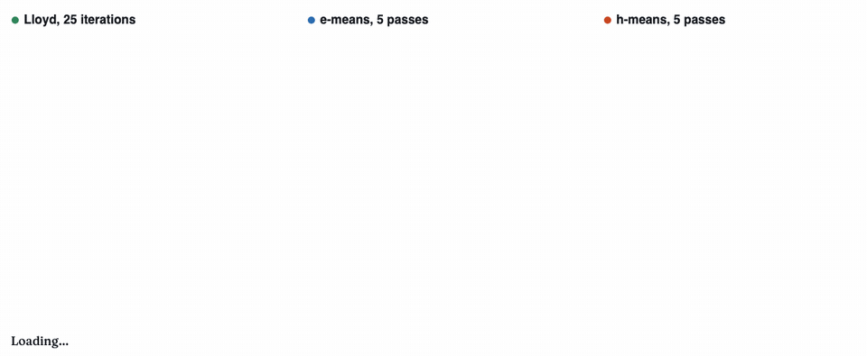

<p align="center"></p>
<h1 align="center">h-means</h1>
<p align="center">Mini-batch k-means with a hierarchical warm start and Hartigan assignment.<br>
e-means, warmed up and corrected: 2 to 7% lower k-means loss at the same cost when clusters are small.</p>
<p align="center">
  <a href="https://h-means.github.io/">Site</a> ·
  <a href="https://h-means.github.io/playground.html">Playground</a> ·
  <a href="paper/hmeans.pdf">Technical note (PDF)</a> ·
  <a href="REPORT.md">Report</a> ·
  <a href="NOTES.md">Lab notes</a> ·
  <a href="notebooks/small_datasets.ipynb">Notebook</a>
</p>
<p align="center">
  <a href="https://github.com/heldernoid/hmeans/actions/workflows/test.yml"></a>
  <a href="https://github.com/h-means/h-means.github.io/actions/workflows/pages.yml"></a>
  <a href="LICENSE"></a>
</p>

<p align="center"></p>
<p align="center"><sub>Three Gaussians plus noise, n = 40,000, k = 800: Lloyd (25 iterations), e-means (5 passes) and h-means (5 passes) on the same points, paced by distance computations. Two dimensions exaggerate the gap; the numbers below are on real embeddings.</sub></p>

## What it is

[e-means](https://e-means.github.io) (Bessa et al., Meta FAIR, 2026) trains k-means on mini-batches with an exponential moving average of cluster statistics and beats Lloyd's algorithm in a tenth of the passes. h-means keeps its update, laws, schedule and dead-cluster revival, and changes two things:

1. **Hierarchical warm start, loss-proportional.** Half a pass of e-means with k/16 coarse centroids, then each coarse cluster is split into children in proportion to its share of the loss and the children are placed by two local Lloyd iterations. About a tenth of a pass.
2. **Hartigan's move rule instead of nearest centroid.** A point moves from cluster a to b only if N_a/(N_a−1)·d²(x,a) > N_b/(N_b+1)·d²(x,b), the exact change of the objective for one move. Written as one matrix product in d+2 dimensions, it costs the same as nearest-centroid search. It runs inside the EMA passes (EMA mass as the size estimate) and in exact passes at the end, whose share of the budget shrinks as clusters grow.

With both switched off the implementation is a faithful e-means and matches the official faiss code within seed noise.

## Results in brief

Training MSE of h-means at 5 passes against the better of e-means's two batch laws at 5 passes, same distance computations, 5 seeds, GPU. Negative is h-means better. Full tables with error bars, held-out loss, timings and ablations: [REPORT.md](REPORT.md) and the [site](https://h-means.github.io/results.html).

| points per cluster | configurations | h-means vs best e-means |
|---|---|---|
| 7 to 9 | SIFT k=131k, GloVe k=131k, NYTimes k=32k | −4.4% to −6.7% |
| 14 to 20 | SIFT k=65k, GloVe k=65k, NYTimes k=16k, Fashion-MNIST k=2k, GMM k=32k | −1.6% to −3.2% |
| 30 to 80 | SIFT k=16k, GloVe k=16k, NYTimes k=4k, Fashion-MNIST k=512, GMM k=8k, GMM-Zipf k=16k | −0.03% to −0.9% |
| 122 and 152 | GMM-Zipf k=4k, Deep-96 (10M rows) k=65k | −2.2%, −0.2% |
| 240 to 480 | SIFT k=2k, k=4k | tie (±0.03%) |

h-means is below the best e-means on all 16 configurations and every seed, with 3 to 10 times smaller seed variance; at 15 points per cluster or fewer it reaches e-means's 5-pass loss in 3 passes. Held-out loss follows at about a fifth of the size (lower on 11 of 15). Lloyd at 25 iterations, k-means++ seeding and Sculley's mini-batch k-means are all behind e-means and therefore behind h-means. Limitations, including that the pass split was chosen on this grid, are stated in the report.

## Install

```
pip install "git+https://github.com/heldernoid/hmeans.git"                    # NumPy backend only (CPU)
pip install "hmeans[torch] @ git+https://github.com/heldernoid/hmeans.git"   # + PyTorch backend: CPU, Apple MPS, CUDA
pip install -e ".[torch,test]"       # from a checkout; ./setup.sh builds the full experiment environment
```

## Use

```python
import numpy as np
from hmeans import HMeans, EMeans

X = np.random.rand(200_000, 64).astype("float32")            # numpy array or torch tensor
km = HMeans(n_clusters=4096, n_passes=5, random_state=0).fit(X)
km.cluster_centers_.shape, km.labels_.shape, km.inertia_       # (4096, 64), (200000,), float
km.predict(X[:10]); km.transform(X[:10]); km.score(X)         # labels, distances, negative SSE
HMeans(n_clusters=4096, backend="numpy").fit(X)                # force the NumPy backend
HMeans(n_clusters=4096, backend="torch", device="cuda").fit(X)
EMeans(n_clusters=4096, n_passes=5).fit(X)                     # the faithful e-means, same interface
```

`HMeans` follows the scikit-learn estimator API (`fit`, `predict`, `fit_predict`, `transform`, `score`, `get_params` / `set_params`, pipelines; scikit-learn itself is optional). `n_passes` is the total number of passes over the data. `backend="auto"` uses torch when it is installed, NumPy otherwise. `ema_frac="auto"` chooses the split between EMA passes and exact Hartigan passes from the points per cluster (0.4 below 24, 0.8 below 64, 1.0 above). `HMeansCore` is the torch implementation with every ablation switch; `HMeansNumpy` the NumPy one. The version comes from git tags (setuptools-scm). `pytest tests` runs the test suite; the torch tests skip when torch is absent.

## Repository

| path | contents |
|---|---|
| `hmeans/` | the library: `estimator.py` (scikit-learn style `HMeans`, `EMeans`), `core_numpy.py`, `hmeans.py` (torch core), `laws.py` (e-means laws), `backend.py`, `baselines.py`, `emeans_ref.py` |
| `tests/` | pytest suite (numpy and torch) |
| `notebooks/` | `small_datasets.ipynb`: Lloyd, k-means++, e-means and h-means side by side on iris, wine, digits and the 2-D toy, with Voronoi cells; runs in seconds, no download |
| `experiments/` | `run.py` (one configuration, one JSON line), `suite.py` (the plans, resumable), `analyze.py` (tables and figures), `export_site_data.py`, `results/*.jsonl` (every logged run) |
| `paper/` | the technical note, `hmeans.tex` and `hmeans.pdf` (`tectonic hmeans.tex` rebuilds it) |
| `site/` | the documentation site, its own repository [h-means/h-means.github.io](https://github.com/h-means/h-means.github.io) (Astro 5; `npm run dev` serves it, `npm run sync` refreshes the PDF and the results data from this repository) |
| `REPORT.md`, `NOTES.md` | the full report, and the investigation log with every idea and measurement in order |

Reproduce everything (about six hours on an M3 Ultra; each plan resumes if interrupted):

```
for p in main v3 scaling scaling_v3 ablation_v3 kmeanspp deep deep_v3 auto; do python experiments/suite.py $p mps; done
python experiments/suite.py cpu cpu; python experiments/suite.py cpu_v3 cpu
python experiments/analyze.py && python experiments/export_site_data.py
```

## Acknowledgement

Claude Fable 5.1 (Anthropic) assisted with the experiment design, the automation of the runs and the drafting of the documents. The method and the results are the author's responsibility.

## License

MIT, see [LICENSE](LICENSE). The playground's 2-D generators and its Lloyd and e-means trainers are adapted from the [e-means playground](https://github.com/e-means/e-means.github.io) (Meta Platforms, MIT); the e-means constants come from faiss `contrib/e_means` (Meta Platforms, MIT).
