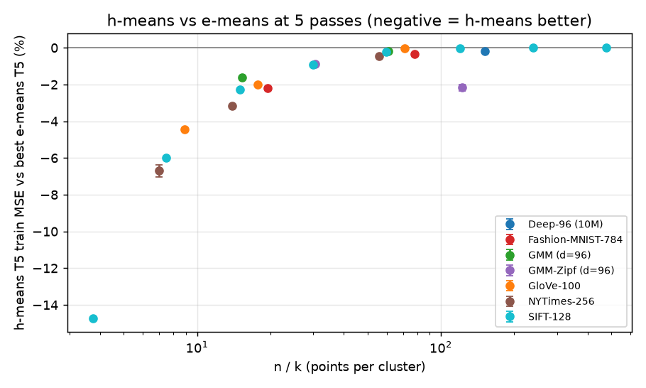

# h-means: report

_All numbers below come from runs logged in `experiments/results/*.jsonl` on one
machine (Apple M3 Ultra: 32 CPU cores, 80-core GPU through PyTorch MPS, 512 GB).
`python experiments/analyze.py` regenerates every table and figure from those
logs; `experiments/tables/*.md` hold the full tables._

## 1. Method

h-means keeps e-means's mini-batch EMA core and changes four things.

1. **Hierarchical warm start with loss-proportional allocation.** Half a pass of
   e-means with k/16 centroids, then each coarse cluster is split into children.
   The number of children a coarse cluster gets is proportional to its SSE
   (largest-remainder apportionment; at least one, at most its point count), and
   the children are placed by two local Lloyd iterations in which each point only
   sees the children of its own coarse cluster. Cost: about 0.1 pass of n·k
   distance computations. The allocation rule is what makes it work on
   imbalanced data (uniform allocation is 6% worse on a Zipf mixture).
2. **SSE-proportional revival donors.** e-means revives dead clusters by
   splitting donors sampled proportionally to their EMA mass; h-means samples
   proportionally to the cluster's running SSE instead. Free, small gain.
3. **Hartigan-corrected assignment inside the EMA passes.** Each mini-batch point
   is assigned with Hartigan's rule (below) instead of the nearest centroid, with
   the cluster size estimated as EMA mass × n/B. This is the only change that
   also helps at n/k ≈ 60 (−0.25% on SIFT k = 16384 by itself).
4. **Exact Hartigan passes, with a pass split that depends on n/k.** After the
   EMA passes, the exact per-cluster sums and counts of all points (available
   for free from the last EMA pass) are maintained incrementally, and every
   mini-batch is re-assigned with Hartigan's rule: move x from cluster a to b iff
   N_a/(N_a-1)·d²(x,a) > N_b/(N_b+1)·d²(x,b). The rule is the exact change of the
   k-means objective for a single move; Lloyd's rule ignores the N/(N±1) factors,
   which matter when clusters are small. All join costs are one matmul of the
   augmented vectors [‖x‖², x, 1]·[g_j, −2 g_j c_j, g_j ‖c_j‖²] with
   g_j = N_j/(N_j+1), so a Hartigan pass costs the same as an exact pass (d+2
   instead of d). Empty clusters cannot be joined through the rule and are
   re-seeded at the farthest point of a mass-sampled donor. The fraction of the
   passes run in EMA mode is 0.4 below 24 points per cluster, 0.8 below 64 and
   1.0 (no exact passes) above: exact passes only make local moves, which is
   what small clusters need and what large clusters do not (§4, §3.4).

Everything else (batch and step laws, cosine schedule, split perturbation,
last-pass-mean finalisation) is e-means's. With the four changes switched off
the implementation is a faithful e-means (matches the official faiss
`NumpyEmeans` within seed noise, see NOTES.md §1).

## 2. Protocol

* Datasets: SIFT-128 (980k train), GloVe-100 (1.16M, L2-normalised),
  NYTimes-256 (270k, L2-normalised), Fashion-MNIST-784 (40k), two synthetic
  Gaussian mixtures (d = 96, 500k; balanced with 4096 components, Zipf-imbalanced
  with 2048), Deep-96 (10M, L2-normalised). 20k rows held out per dataset.
* k from n/k ≈ 60 down to n/k ≈ 8 (the paper's laws were fitted for n/k ≥ 8).
* Baselines: Lloyd@25 random init (3 seeds), Lloyd@25 with greedy k-means++ init,
  Sculley mini-batch (B = 4096, reassignment 0.01, 5 passes, 3 seeds), e-means at
  3 and 5 passes with its default (`throughput`) law and at 5 passes with its
  `quality` law (B 8x smaller; better on this hardware), 5 seeds. "Best e-means"
  below means the better of the two laws per configuration. All methods
  run on the same torch backend (exact assignment by matmul + argmin), same
  random-row init per seed, same evaluation.
* Metrics: exact train MSE on all training rows and exact held-out MSE (float32
  distances recomputed directly, not through the matmul expansion); wall-clock
  of `fit` (device-synchronised); distance computations in units of n·k ("passes").
* h-means at 3 and 5 total passes (its warm start adds ~0.1 pass, counted).

## 3. Results

Recipe selection, stated up front: three fixed recipes were run on the full
grid, in this order. v1 (no Hartigan correction inside the EMA passes), then v2
(Hartigan-EMA, 80% of the passes in EMA mode; chosen after a two-seed CPU side
test at n/k ≈ 60), then v3 (Hartigan-EMA, 40% EMA) after the full grid showed v2
losing most of v1's gain at n/k ≤ 15. v3 won below 20 points per cluster, v2
between 30 and 60, and neither at n/k ≥ 120 (§3.4); a synthetic check at 234
points per cluster then showed that the exact tail itself is the problem there
(§4). The final recipe therefore sets the EMA fraction from n/k (0.4 below 24,
0.8 below 64, 1.0 above). "h-means" below is that rule applied to the logged
runs: the v3 rows where the rule gives 0.4, the v2 rows where it gives 0.8, and
runs made afterwards with ema_frac = 1.0 where it gives 1.0 (`auto.jsonl`). The
thresholds were chosen on the same grid that is reported; there is no held-out
set of configurations (see §5). All fixed-recipe rows are kept in
`experiments/tables/main.md`.

### 3.1 Main grid (5 seeds, exact train MSE, 5 passes of n·k distance computations)

h-means at 5 passes versus the better e-means law at 5 passes, mean over 5 seeds
(± is the seed std of h-means as a percentage of the e-means mean). Negative is
h-means better. Full table: `experiments/tables/wins.md` and `main.md`.

| dataset | k | n/k | h-means T5 vs best e-means T5 | h-means T5 vs e-means T5 (default law) | h-means T3 vs best e-means T5 | seeds won |
|---|---|---|---|---|---|---|
| Fashion-MNIST-784 | 512 | 78 | −0.35% (±0.04) | −0.52% | +0.01% | 5/5 |
| Fashion-MNIST-784 | 2,048 | 20 | −2.19% (±0.04) | −2.53% | −1.49% | 5/5 |
| GloVe-100 | 16,384 | 71 | −0.03% (±0.01) | −0.22% | +0.37% | 5/5 |
| GloVe-100 | 65,536 | 18 | −2.02% (±0.01) | −2.57% | −1.21% | 5/5 |
| GloVe-100 | 131,072 | 9 | −4.44% (±0.02) | −5.74% | −3.65% | 5/5 |
| NYTimes-256 | 4,096 | 56 | −0.46% (±0.02) | −0.59% | +0.04% | 5/5 |
| NYTimes-256 | 16,384 | 14 | −3.15% (±0.08) | −4.96% | −2.43% | 5/5 |
| NYTimes-256 | 32,768 | 7 | −6.70% (±0.34) | −9.66% | −5.94% | 5/5 |
| SIFT-128 | 16,384 | 60 | −0.24% (±0.00) | −0.43% | +0.46% | 5/5 |
| SIFT-128 | 65,536 | 15 | −2.26% (±0.01) | −3.07% | −0.97% | 5/5 |
| SIFT-128 | 131,072 | 7 | −5.97% (±0.01) | −7.26% | −4.27% | 5/5 |
| GMM-Zipf (d = 96) | 4,096 | 122 | −2.16% (±0.17) | −2.16% | −1.92% | 5/5 |
| GMM-Zipf (d = 96) | 16,384 | 31 | −0.89% (±0.00) | −1.02% | −0.57% | 5/5 |
| GMM (d = 96) | 8,192 | 61 | −0.18% (±0.02) | −0.18% | −0.08% | 5/5 |
| GMM (d = 96) | 32,768 | 15 | −1.62% (±0.00) | −1.62% | −1.29% | 5/5 |

* **The gain is a function of points per cluster.** 0.03 to 0.5% at n/k ≈ 60
  to 80, 1 to 2.5% at n/k ≈ 15 to 20, 4.5 to 7% at n/k ≈ 7 to 9. h-means is
  below the best e-means on all 15 configurations and all 75 seed runs; the
  smallest margin is GloVe k = 16384 (−0.03%, within one seed std of a tie).
* **Fewer passes for the same loss.** At n/k ≤ 20, h-means at 3 passes is already
  below e-means at 5 passes (−1.0% to −5.9%). On the seed-0 held-out curves
  (`experiments/figures/curve_*.png`) h-means reaches e-means's 5-pass loss after
  about 3.1 passes on most configurations and after 2.1 passes on NYTimes
  k = 16384 / 32768.
* **Seed variance is smaller.** The seed std of h-means is typically 3 to 10x
  smaller than e-means's with the default law (SIFT k = 65536: 1.6 vs 16.3; GloVe
  k = 131072: 0.4e-4 vs 1.3e-4 in the table units).
* **Baselines behave as published.** e-means at 5 passes beats Lloyd@25 by 0.7 to
  3% everywhere except NYTimes k = 32768 (n/k = 7, outside the paper's fitted
  range), where Lloyd@25 is 1.4% better than e-means and h-means is 8.4% better
  than Lloyd. Sculley's mini-batch at 5 passes is 1.4 to 19% worse than e-means.
  Greedy k-means++ (50k sample, 3 trials) followed by Lloyd@25 is 0.5 to 1.3% worse
  than e-means at 5 passes and 50 to 100x slower; seeding on the full SIFT data
  (one seed, 419 s of seeding) reaches 38107, still 0.7% above e-means T5 and 0.9%
  above h-means T5.

### 3.2 Held-out loss

h-means optimises the training objective, and the held-out picture is weaker
(`experiments/tables/wins.md`, last columns). Held-out MSE of h-means T5 versus
the best e-means T5: lower on 11 of 15 configurations (Fashion-MNIST −0.19 /
−0.40%, GloVe k = 65536 −0.09%, NYTimes −0.21 / −1.00 / −1.23%, SIFT −0.03 /
−0.54 / −1.12%, GMM-Zipf −2.15 / −0.04%), within ±0.05% on two, and higher on
GloVe k = 16384 (+0.12%) and the balanced GMM at k = 32768 (+0.70%). With 15 points per cluster the exact Hartigan passes fit the training
rows; on the synthetic balanced mixture, where the generating components are
exactly recoverable, that is pure overfitting. On the real datasets the held-out
gain tracks the train gain at about one fifth of its size.

### 3.3 Wall-clock

Accelerator (MPS) `fit` time at 5 passes, seconds, mean over seeds, e-means T5
(default law) / h-means T5 / h-means T3:

| | SIFT 65k | SIFT 131k | GloVe 65k | GloVe 131k | NYTimes 32k | GMM 32k | Fashion 2k |
|---|---|---|---|---|---|---|---|
| e-means T5 | 16.1 | 31.8 | 18.6 | 36.5 | 1.7 | 2.1 | 0.3 |
| h-means T5 | 14.4 | 27.1 | 16.4 | 31.8 | 4.9 | 3.8 | 1.1 |
| h-means T3 | 9.8 | 18.3 | 11.2 | 20.8 | 3.0 | 3.5 | 1.2 |

On the large problems (≥ 15 s) h-means is 10 to 15% faster at equal passes
(Hartigan passes use fewer, larger kernels than the EMA passes) and h-means T3
gives a lower loss than e-means T5 in 60% of its time. On the small problems
(n ≤ 500k, under 5 s) h-means is 2 to 5x slower at equal passes: the warm start
and the per-batch Hartigan bookkeeping are fixed costs that dominate at that
scale, and e-means's default law uses very large batches there. Distance
computations are the hardware-independent comparison; §3.5 gives CPU times.

### 3.4 SIFT k-sweep, Deep-10M

**SIFT k-sweep** (n = 980k, 3 seeds, 5 passes, `experiments/tables/scaling.md`,
final recipe). Train MSE, h-means vs the better e-means law:

| k | n/k | e-means T5 | e-means T5 quality | h-means T5 | h-means vs best | time e-means / h-means (s) |
|---|---|---|---|---|---|---|
| 2,048 | 479 | 47239 ± 4 | 47200 ± 5 | 47213 ± 2 | +0.03% | 0.7 / 2.0 |
| 4,096 | 239 | 44192 ± 5 | 44148 ± 3 | 44157 ± 2 | +0.02% | 1.0 / 2.3 |
| 8,192 | 120 | 41113 ± 8 | 41051 ± 2 | 41040 ± 2 | −0.03% | 1.5 / 2.6 |
| 16,384 | 60 | 37831 ± 2 | 37757 ± 1 | 37668 ± 1 | −0.24% | 2.6 / 3.7 |
| 32,768 | 30 | 34185 ± 9 | 34024 ± 1 | 33705 ± 4 | −0.94% | 4.5 / 6.1 |
| 65,536 | 15 | 29718 ± 16 | 29480 ± 2 | 28809 ± 4 | −2.28% | 15.1 / 15.5 |
| 131,072 | 7 | 23996 ± 49 | 23681 ± 5 | 22264 ± 1 | −5.98% | 30.4 / 29.1 |
| 262,144 | 4 | 16714 ± 68 | 16448 ± 10 | 14026 ± 0 | −14.73% | 60.0 / 67.1 |

Above about 100 points per cluster h-means (EMA fraction 1.0 there) is a tie
with e-means's quality law (within ±0.03%) and 0.05 to 0.2% below its default
law. From 60 points per cluster down the gain grows to 15% at four points per
cluster. With a fixed 0.4 split the large-n/k end was +0.25% and with a fixed
0.8 split +0.07%; the small end was −7.4% with 0.8 and −14.7% with 0.4, which
is what the adaptive split resolves.

**Deep-10M** (Deep-96, 9.97M rows, k = 65,536, n/k = 152, 2 seeds; the
IVF-training regime). Final recipe (EMA fraction 1.0): h-means T5 0.328614 vs
e-means T5 0.329273 (−0.20%), held-out −0.15%, 135.5 s vs 151 s. With the fixed
0.4 split it was a tie (+0.00%, 152 s) and with 0.8 −0.23% (141 s). Lloyd@25:
+0.50% in 733 s; e-means T3: +0.36% in 93 s; h-means T3: +0.16% in 93 s.

### 3.5 CPU

Torch CPU backend (32 cores), 3 seeds, `experiments/tables/cpu.md`. The CPU
runs shared the machine with GPU jobs, so timings carry about ±10% noise. The
official faiss `NumpyEmeans` is included as a correctness reference; its
assignment goes through `faiss.knn`, about 4x slower than a torch matmul here,
so the torch rows are the like-for-like comparison.

| dataset, k | e-means T5 (torch) | faiss official T5 | h-means T5 | h-means T3 | Lloyd@25 |
|---|---|---|---|---|---|
| SIFT 16,384 | 37830 in 19.6 s | 37830 in 76.8 s | 37759 in 15.4 s | 38049 in 12.0 s | 38234 in 100.5 s |
| SIFT 65,536 | 29718 in 78.7 s | 29719 in 304 s | 28809 in 61.0 s | 29191 in 40.6 s | – |
| GloVe 16,384 | 0.54744 in 23.3 s | 0.54747 in 90.9 s | 0.54618 in 25.0 s | 0.54888 in 16.1 s | 0.55257 in 118.8 s |
| GloVe 65,536 | 0.48046 in 98.8 s | 0.48048 in 325 s | 0.46807 in 92.4 s | 0.47200 in 59.0 s | – |

At k = 65,536 h-means reaches a lower loss than e-means at 5 passes in about
half the time (3 passes: 29191 vs 29718 in 40.6 vs 78.7 s on SIFT; 0.4720 vs
0.4805 in 59 vs 99 s on GloVe). At k = 16,384 the losses are within 0.3% and
the times within noise. Against the official code, h-means at 3 passes gives a
better loss in one seventh of the time at k = 65,536.

## 4. Ablations

Five passes, five seeds, each component switched off in turn, relative to the
recipe with the fixed 0.4 split (`experiments/tables/ablation.md`; the earlier
ablation against the 0.8 split is in `ablation_v2.md`). Train MSE relative to
that full recipe; negative is better than it.

| variant | GloVe k = 65,536 (n/k 18) | SIFT k = 65,536 (15) | SIFT k = 16,384 (60) | GMM-Zipf k = 4,096 (122) |
|---|---|---|---|---|
| full (warm start, SSE donors, Hartigan-EMA, 40% EMA, Hartigan tail) | 0 | 0 | 0 | 0 |
| − SSE donors (mass donors) | −0.00% | +0.00% | +0.00% | −0.01% |
| − SSE allocation (uniform children) | +0.08% | +0.11% | +0.01% | **+9.46%** |
| − Hartigan in EMA phase | +0.16% | +0.37% | +0.07% | −0.01% |
| − warm start | +0.56% | +0.61% | +0.20% | +2.78% |
| − Hartigan tail (EMA only, same passes) | +1.61% | +1.50% | −0.24% | −0.24% |
| − Hartigan rule in tail (Lloyd-rule tail) | +2.31% | +2.64% | +0.55% | +0.22% |
| ema_frac 0.8 | +0.64% | −0.08% | −0.25% | −0.28% |
| ema_frac 1.0 (no tail) | +1.61% | +1.50% | −0.24% | −0.31% |
| e-means + Hartigan-EMA only | +1.91% | +2.17% | −0.14% | +1.89% |
| e-means (all off) | +2.64% | +3.19% | +0.18% | +2.08% |

* **The Hartigan tail is the largest single lever at small n/k** (1.5 to 1.6%),
  and it is the N/(N±1) rule, not the exact bookkeeping, that matters: a
  Lloyd-rule tail with identical bookkeeping is 2.3 to 2.6% worse than the
  Hartigan tail and worse than no tail at all.
* **The warm start is worth 0.2 to 2.8%**, most on the imbalanced mixture, and
  its loss-proportional allocation is what makes it survive imbalance: uniform
  children cost 9.5% on the Zipf mixture.
* **Hartigan-corrected EMA assignment** adds 0.1 to 0.4% at small n/k and
  nothing at n/k ≥ 60.
* **SSE-proportional donors do nothing** measurable; kept as an option, not part
  of the claim.
* **The split is regime-dependent**, which is what the adaptive rule encodes: at
  n/k = 15 to 18 the 0.4 split is best or within 0.1% of best; at n/k = 60 and
  122 the 0.8 and 1.0 splits are 0.25 to 0.3% better than 0.4 and
  indistinguishable from each other.
* "e-means (all off)" is the faithful reimplementation; the full recipe is 2.1
  to 3.2% below it at n/k ≤ 18, 0.2% at n/k = 60 and 2.1% on the Zipf mixture
  (where the warm start carries the gain).

## 5. Limitations

* **Regime.** Above about 200 points per cluster h-means ties e-means's
  quality law on SIFT (±0.03%) and is 0.03 to 0.5% below the best e-means at
  n/k ≈ 60 to 150; its clear wins are a small-cluster effect. The paper's laws
  were fitted for n/k ≥ 8 and the authors target n/k ≈ 100 to 1000 for IVF
  training; there h-means is a tie to a small win (Deep-10M −0.20%). Where
  h-means wins by 5 to 7% (n/k ≈ 7) Lloyd@25 is also competitive with e-means.
* **Held-out.** Train gains translate to held-out gains at about a fifth of the
  size on real data and can reverse on separable synthetic data at n/k = 15 (§3.2).
* **The pass split is a heuristic in n/k only.** Its two thresholds (24 and 64
  points per cluster) were set from the grid, the SIFT sweep and one synthetic
  check; the ablation shows the 0.4 and 0.8 splits within 0.1% of each other at
  n/k = 15 and 0.6% apart at n/k = 18, so the lower threshold is soft. Other
  properties of the data (separability, imbalance) are not used.
* **Selection on the reported grid.** The final recipe (v3) was chosen after
  seeing all three recipes on the full grid. The Deep-10M, k-sweep, CPU and
  ablation runs were made afterwards and are the only results the choice did
  not see; the main grid should be read as "best of three recipes", with v1 and
  v2 within 1 to 3 percentage points of v3 at the small-n/k end and all three
  beating e-means there.
* **Hyperparameters.** For the user h-means has the same two inputs as e-means,
  k and the pass budget; batch size and step size come from the e-means laws,
  the coarse level (k/16), the two local Lloyd iterations and the EMA constants
  are fixed. The one method constant that e-means does not have, the pass split
  as a function of n/k, was set on the same grid the report evaluates. e-means
  fitted its laws on a dedicated sweep and evaluated elsewhere; the split rule
  has not had that separation. Deep-10M and the SIFT sweep extremes, run after
  the rule was fixed, are the only out-of-sample checks of it.
* **Wall-clock at small scale.** On problems that take e-means under 5 s on the
  accelerator, h-means is 2 to 5x slower at equal passes (§3.3). The
  implementation is not tuned (Python loop per mini-batch, two scatter-adds per
  Hartigan batch); the operation count is the fair comparison.
* **One machine, one backend.** Everything ran on one Apple M3 Ultra through
  PyTorch (MPS and CPU). The official faiss implementation was used only as a
  correctness cross-check on CPU; a CUDA comparison against the official code
  was not possible here.
* **Memory.** The Hartigan passes keep an int64 label per point and exact
  per-cluster sums (k × d float32); e-means keeps only the centroids.
* **Low-d playground.** The 2-D demo (35 to 48% lower loss) is the regime the
  e-means authors explicitly flag as outside their laws (revival off at d ≤ 2);
  it is a demonstration, not part of the claim.
* **Dead ends** (NOTES.md §2): cached / graph / bounded / PCA approximate
  assignment, IVF first pass, growing batches, a Lloyd-rule incremental tail.
  None beat exact assignment at equal wall-clock on this hardware.

## 6. Verdict

Within its regime, h-means beats e-means on the mission's own terms:

* **Lower loss at equal distance computations and equal or lower wall-clock on
  the large problems**: 2 to 7% lower train MSE at 5 passes for n/k ≤ 20 on four
  real datasets and two synthetic mixtures, on every seed, with 3 to 10x
  smaller seed variance. The same loss in 3 passes instead of 5 at n/k ≤ 15.
* **No loss elsewhere**: at n/k ≈ 60 to 150 h-means is 0.03 to 0.5% below the
  best e-means on every configuration including Deep-10M, ties it within
  ±0.03% at n/k ≥ 240 on the SIFT sweep, and beats Lloyd@25, Sculley and
  k-means++ by the same margins e-means does.

What it does not do: it is not a breakthrough at the IVF-training scale of
hundreds of points per cluster, where e-means's own recipe is already at the
Lloyd fixed point; and its held-out gains are a fraction of its train gains.
The honest one-line summary is: e-means plus a loss-proportional hierarchical
warm start and Hartigan's N/(N±1) correction is a strictly better optimiser of
the k-means objective when clusters are small, and the same algorithm when they
are not.
